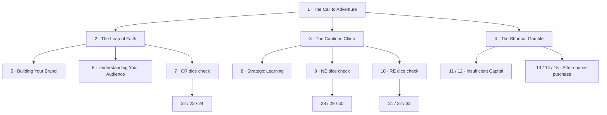

# Branching structure and reproducible validation

The source is the complete 245-page PDF identified in [`manuscript/source.json`](../manuscript/source.json), SHA-256 `145b34277d44ac043a0ea12a69117032dc5b53b06bda2f959974c21efcf7e9e9`. Physical PDF page numbers are 1-based. They are not printed page labels or story section IDs.

## Extracted database

- [`pages.json`](../manuscript/pages.json) retains the exact extracted text of all 245 physical pages, including setup, appendices, and printed page labels. A second field removes identified printed footers only.
- [`sections.json`](../manuscript/sections.json) contains all **284 unique numbered sections, IDs 1–284**. Each record retains its original heading, body, raw text, physical source pages, destination references, and source-linked evidence matches for mechanics.
- [`branching.json`](../manuscript/branching.json) contains every extracted edge and reproducible graph statistics. There are **738 explicit numeric reference occurrences / 735 unique pairs**, or **742 occurrences / 739 unique pairs** including nonnumeric authored “Restart Act 1” transitions.
- [`rules.json`](../manuscript/rules.json) indexes source-linked mechanics evidence from the front matter and appendices, including the five bonus perks and mentor profiles.
- Extraction records are explicitly `extracted-unreviewed`. Evidence searches are aids for reviewing the PDF; they are not complete executable interpretations. Verified prototype mechanics live separately in application content.

Headings use both periods and colons. The extractor uses heading typography and same-line title text so isolated destination lines such as `20.` and `104.` are not mistaken for new sections. Wrapped headings are retained. PDF line wrapping and zero-width extraction artifacts remain visible in archival text; the exact page extraction is always available for comparison.

## Opening structure



| Section | Original destinations |
| --- | --- |
| 1 | 2, 3, 4 |
| 2 | 5, 6, 7 |
| 3 | 8, 9, 10 |
| 4 | 11, 12 when Capital is insufficient; 13, 14, 15 after buying the course |
| 5 | 16, 17, 18 |
| 6 | 19, 20, 21 |
| 7 | 22, 23, 24 according to 2d6 + Creativity |
| 8 | 25, 26, 27 |
| 9 | 28, 29, 30 according to 2d6 + Networking |
| 10 | 31, 32, 33 according to 2d6 + Resilience |

Section 10 provides a compact complete dice-and-consequence path: 31 grants $2,000; 32 grants $1,000 and reduces Tactics by 1; 33 grants no funding. Playable content and declared prototype boundaries are validated separately from the complete manuscript database. A boundary keeps the original target ID and is not represented as an authored ending.

## Structural findings

**No missing destination IDs, duplicate section IDs, or gaps in story numbering were detected.** This does not establish semantic correctness or state-dependent reachability.

| Finding | Physical PDF pages | Evidence and impact |
| --- | --- | --- |
| Section 43 has no incoming link | 48 | Its roll leads to 158, 159, or 160, but no current section leads into 43. |
| Section 153 has no incoming link | 128 | An entire strategy-reset section is disconnected. |
| Sections 159 and 160 are unreachable | 132–133 | Their only incoming links are from unreachable section 43. Section 158 has other incoming paths. |
| 134 → 161 → 134 | 115, 133 | 134 grants $2,000. Reapplying its reward on return can repeat the gain. |
| 170 → 198 → 170 | 138, 161 | 170 grants $4,000; 198 loses $1,000 and returns to 170. Re-entry rewards would produce $3,000 per cycle. |
| 176 → 199 → 176 | 142–143, 161 | 176 grants $4,000. 199 says “Go back to 176 and choose again.” Repeating the entry reward materially changes play. |

Excluding restart transitions, the graph contains one 155-section cyclic component and three two-section components: 39 ↔ 147, 134 ↔ 161, and 176 ↔ 199. The simple 170 ↔ 198 reward loop lies inside the larger component. Cycles can be intentional. The validator reports all component IDs without treating them as broken links. The manuscript does not receive invented links, reward caps, or automatic loop corrections.

Section 280 (physical page 218) is the ordinary terminal victory. Section 284 (pages 220–221) resolves its roll directly to victory or restart. Restart instructions also occur in 15, 22, 96, 112, 269, and 276. Sections 281–283 all target 284 using different wording; those references are included. No unexplained dead end was detected.

## Reproduce the audit

```bash
python -m pip install PyMuPDF
python scripts/extract-manuscript.py /path/to/the-original-manuscript.pdf
node scripts/validate-story.mjs
node scripts/validate-story.mjs --json
```

The extraction step rewrites only `manuscript/*.json`. It requires the original PDF and records the extractor version. The validator uses Node built-ins and does not modify files. It exits nonzero for duplicate IDs, missing references, invalid source pages, unknown prototype IDs, altered or omitted original destinations, or destinations outside the prototype without declared boundaries. Known unreachable content and potential loops are reported as warnings with section IDs.

The validator discovers `src/content/prototype-manifest.json` when available, or reads the pure JSON `GAME` initializer and literal `PLAYABLE_SECTION_IDS` / `PROTOTYPE_BOUNDARY_TARGETS` exports from `src/content/game.ts`. It checks the actual authored choice and roll targets without executing TypeScript. A JSON manifest supplies `sectionIds`, `boundaryTargets`, and `scenes` records containing `id`, `choiceTargets`, and `rollTargets`. Use `--sections PATH` and `--prototype PATH` to validate alternate fixtures. A TypeScript file exposing only IDs receives an explicit warning that authored navigation could not be checked.
